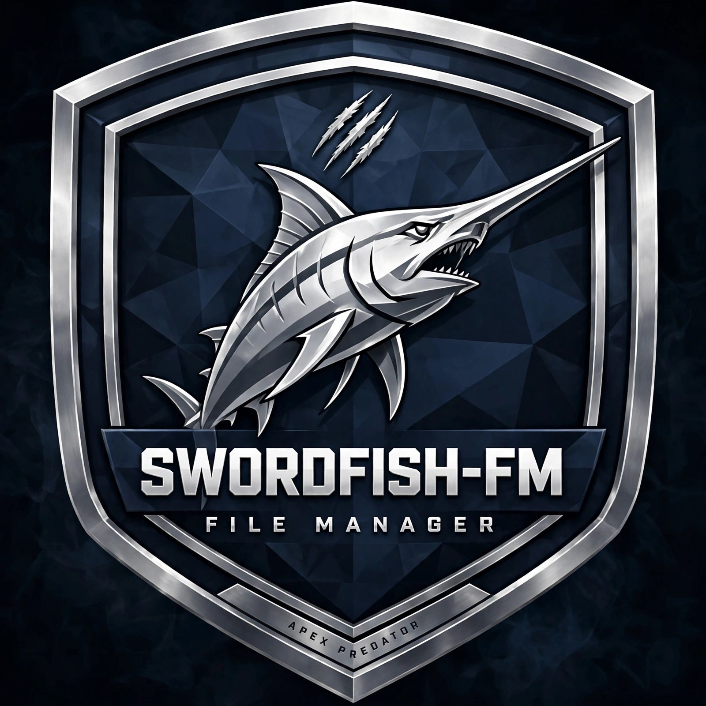
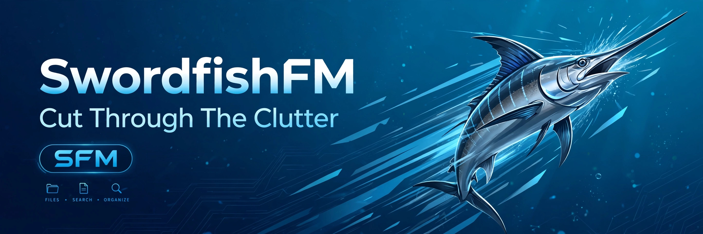

  

# Swordfish FM

> **Swordfish-Portable v0.0.1 RC2 — release candidate available for testing**
>
> RC2 supersedes RC1. Please use RC2 for testing; RC1 has known application
> launching and terminal problems. The planned no-internal-apps redesign is
> future work, not part of RC2.
> 
> About the name **SwordFish**, The original XFE file manager is known for its speed and versatility, ad I am a life long avid angler, I wanted to choose a name that reflects both the ethos of XFE, and combine with my hobby, Swordfish is one of the fastest and most agile top ocean predators, hence the name ;}
> 
> I hope **SwordFish-FM** will live up to expectations and satisfies your needs.

## 🙏 Credits & Acknowledgments

Swordfish FM is based on **Xfe (X File Explorer)** — a lightweight file manager for X11.

- **Original Author & Maintainer of Xfe:** [Roland Baudin (roland65)](https://github.com/roland65/xfe)
- **Based on:** X Win Commander by Maxim Baranov
- **Homepage:** http://roland65.free.fr/xfe/

All credit for the original Xfe codebase goes to Roland. Swordfish FM is a modern continuation / fork inspired by his work.

## 📜 License

This project is based on Xfe, which is licensed under the **GNU General Public License v2.0 (GPLv2)**.

- Original Xfe License: GPLv2
- Swordfish FM will maintain GPLv2 compatibility.

See [COPYING](COPYING) for full details..
Copyright (C) Roland Baudin and contributors.

> If **XFE** is the root, **Swordfish FM** aims to be the evolution.

## Portable Linux release candidate

A portable Linux build lets you run Swordfish without installing it into the
system. It currently supports 64-bit x86 Linux.

### Download and run Swordfish

The portable build runs on 64-bit x86 Linux. It does not install Swordfish
system-wide or require extra software to download it.

1. Open the [Swordfish Portable RC2 release](https://github.com/hasmak-44/Swordfish-FM/releases/tag/swordfish-portable-0.0.1-rc2)
   and download the Linux x86_64 ZIP under **Assets**.
   Your browser downloads the ZIP using its normal download settings.
2. Extract the ZIP to the place where you want to keep Swordfish. The ZIP
   contains the complete `Swordfish-Portable` folder. **Extract the whole
   folder; do not move files out of it. Keep the folder together.**
3. To update an existing copy, extract the new `Swordfish-Portable` folder
   over the old one in the same location. If asked, choose to replace the
   existing app files. Your settings and customizations in `portable-data`
   stay in place. To keep an older version too, extract the new folder
   somewhere different; both versions can be run side by side.
4. To start Swordfish, open the `Swordfish-Portable` folder and double-click
   `AppRun`. If Linux asks, choose **Run**. You can also open a terminal in
   that folder and run `./AppRun`, or create a desktop launcher whose command
   points to the `AppRun` file in your Swordfish folder.

This is a release candidate for testing, not a system-wide installation.

For technical details or to build it yourself, see
[portable/README.md](portable/README.md).
